# AURA AI — Assistive Vision for Visually Impaired Users

> **Empowering independence through real-time dual-engine vision, acoustic proximity sonar, and hands-free bilingual voice interaction.**

AURA AI is a 100% voice-first, accessible web application designed specifically for blind and low-vision individuals. It pairs **local zero-latency edge detection (TensorFlow.js)** for obstacle avoidance and proximity sonar with **on-demand cloud intelligence (Google Gemini + OpenAI)** for currency recognition, OCR, and conversational scene understanding.

---

## Architecture & Dual-Engine Overview

```
                      +---------------------------------------+
                      |       AURA AI Voice Interface        |
                      |   (Hands-free Wake Word / Barge-in)   |
                      +-------------------+-------------------+
                                          |
                   +----------------------+----------------------+
                   |                                             |
                   v                                             v
       [ Engine A: Local Radar ]                     [ Engine B: Cloud Vision ]
       TensorFlow.js (COCO-SSD)                      Gemini Vision / GPT-4o-mini
    ------------------------------                 ------------------------------
    * Zero latency (WebGL local)                   * Triggered on user command
    * 25 FPS live video processing                 * Currency note identification
    * Dynamic distance sonar beeps                 * "What's ahead" scene analysis
    * 5-10s spoken obstacle alerts                 * OCR text & medicine labels
    * Pedestrian & vehicle priority                * Conversational scene Q&A
```

---

## Project Structure Flowchart

```mermaid
flowchart TD
    Root["AURA AI Root Directory"]

    Root --> Config["Configuration & Environment"]
    Config --> Env[".env (API Keys: Gemini & OpenAI)"]
    Config --> EnvEx[".env.example (Template)"]
    Config --> GitIgn[".gitignore (Secures secrets & builds)"]
    Config --> Pkg["package.json & lock (Dependencies)"]
    Config --> ViteConf["vite.config.js (Vite configuration)"]

    Root --> Backend["Backend Services (Node.js & Express)"]
    Backend --> Server["server.js"]
    Server --> EndHealth["/api/health (System diagnostics)"]
    Server --> EndAnalyze["/api/analyze (Dual-engine vision router)"]
    Server --> EndTTS["/api/tts (Google Translate native MP3 audio stream)"]

    Root --> Frontend["Frontend Application (src/)"]
    Frontend --> AppJSX["src/App.jsx (Voice-first UI & State Machine)"]
    Frontend --> MainJSX["src/main.jsx (React DOM entry)"]
    Frontend --> StylesCSS["src/styles.css (Acoustic hub & high-contrast styling)"]
    Frontend --> Hooks["src/hooks/ (Core Modular Hooks)"]

    Hooks --> HookCam["useCamera.js (Clean rear camera feed & frame capture)"]
    Hooks --> HookTF["useTensorflow.js (COCO-SSD local radar & sonar beeps)"]
    Hooks --> HookSpeech["useSpeech.js (Wake word, barge-in & single AI voice)"]
    Hooks --> HookGemini["useGemini.js (On-demand cloud vision connector)"]

    Root --> Tests["Automated Test Suites (scratch/)"]
    Tests --> TestClass["test-classifier.js (40 voice intent tests)"]
    Tests --> TestDetect["test-detection.js (TensorFlow model verification)"]
    Tests --> TestWarn["test-warnings.js (83-class bilingual vocab tests)"]

    Root --> Dist["Compiled Production Build (dist/)"]
    Dist --> DistHTML["dist/index.html"]
    Dist --> DistAssets["dist/assets/ (Bundled CSS & JS)"]
```



---

## Key Features

### 1. Minimal, Clean, Flicker-Free Accessibility UI
- **Zero Visual Clutter**: Detection bounding boxes, visual tags, and on-screen transcripts have been eliminated in favor of clean audio feedback.
- **Acoustic Pulse Hub**: A warm, high-contrast focal area indicating listening, speaking, and alert statuses with smooth CSS transitions and zero layout shifts.

### 2. Engine A: Local Proximity Radar & Sonar Beeps
- **Instant Response**: Operates directly in the browser via WebGL with 0 ms network dependency.
- **Dynamic Sonar Proximity Modulation**:
  - **Volume / Intensity**: Scales from gentle `$0.08$` (distant object) up to loud `$0.40$` (critical collision distance).
  - **Beep Tempo**: Accelerates from `$900\text{ ms}$` (far) down to `$110\text{ ms}$` (continuous rapid warning).
  - **Pitch Frequency**: Sweeps from `$380\text{ Hz}$` (deep calm ping) up to `$1060\text{ Hz}$` (piercing alarm).
  - **Haptic Feedback**: High-frequency dual vibration `$ [140\text{ms}, 50\text{ms}, 140\text{ms}] $` triggers within `$ <1.2\text{ m} $`.
- **Moving Hazard Multipliers**: Vehicles (`car`, `bus`, `truck`, `motorcycle`, `bicycle`) and pedestrians (`person`) receive a `$ 2.0\times - 2.5\times $` priority boost over stationary furniture.
- **Periodic Voice Warnings**: Announces obstacles every 5 to 10 seconds to prevent repetitive speech fatigue.

### 3. Engine B: Cloud On-Demand Scene Intelligence
- **Dual Cloud Failover**: Connects with **Google Gemini** as primary with seamless fallback to **OpenAI (`gpt-4o-mini`)**.
- **Banknote & Currency Recognition**: Identifies Indian Rupee notes, denominations, and flags counterfeit indicators.
- **Reading & OCR**: Reads street signs, medicine packaging, expiry dates, and documents.
- **Conversational Scene Q&A**: Answers natural questions (e.g., *"What color is this shirt?"*, *"Is there a door on my left?"*).

### 4. Continuous Voice Controller & Barge-in
- **Hotword & Direct Commands**: Understands both wake-word-prefixed phrases (*"Hey Aura, check money"*) and immediate direct commands (*"Stop detection"*, *"Alert on"*).
- **Instant Barge-in**: Hearing the wake word or stop commands immediately cancels ongoing speech and switches attention to the user without freezing.
- **Echo Cancellation & Deduplication**: Prevents speaker voice audio from re-triggering microphone recognition, and deduplicates rapid interim events within `$ 800\text{ ms} $`.

---

## Voice Commands Reference

| User Intent | English Voice Commands | Hindi Voice Commands (हिन्दी) |
| :--- | :--- | :--- |
| **Start Alert Radar** | *"Alert on"*, *"Start detection"*, *"Alert mode on"*, *"Camera alert"* | *"अलर्ट चालू"*, *"डिटेक्शन चालू"*, *"अलर्ट मोड चालू"* |
| **Stop Alert Radar** | *"Stop detection"*, *"Alert off"*, *"Stop alerts"*, *"Cancel detection"* | *"अलर्ट बंद"*, *"डिटेक्शन बंद"*, *"पहचान बंद"* |
| **Check Currency** | *"Check money"*, *"Check note"*, *"Currency"*, *"How much money"* | *"नोट चेक करो"*, *"रुपये बताओ"*, *"पैसे देखो"* |
| **Scene Description** | *"What's ahead"*, *"Describe"*, *"What do you see"*, *"Scan ahead"* | *"सामने क्या है"*, *"आगे क्या दिख रहा है"*, *"रास्ता दिखाओ"* |
| **Read Text / OCR** | *"Read text"*, *"Read this"*, *"What is written"* | *"लिखा हुआ पढ़ो"*, *"बोर्ड पढ़ो"*, *"दवा का नाम पढ़ो"* |
| **Mute / Unmute Beeps**| *"Mute"*, *"Beeps off"*, *"Unmute"*, *"Beeps on"* | *"आवाज़ बंद"*, *"बीप बंद"*, *"आवाज़ चालू"* |
| **Ask Any Question** | *"Hey Aura, [your question]"* | *"हे ऑरा, [आपका सवाल]"* |

---

## Proximity Sonar Distance Matrix

| Distance Envelope | Closeness Metric | Volume / Loudness | Pulse Rate | Sound Pitch | Haptics | Spoken Alert Interval |
| :---: | :---: | :---: | :---: | :---: | :---: | :---: |
| **Distant Hazard** (`>3.5m`) | `0.0` | **`0.08`** (Gentle) | **`900 ms`** (Slow) | **`380 Hz`** (Calm) | Off | Immediate on first detection |
| **Approaching** (`~2.0m`) | `0.5` | **`0.24`** (Noticeable) | **`480 ms`** (Moderate)| **`720 Hz`** (Alert) | Off | Repeats every **6.5 seconds** |
| **Critical Collision** (`<1.2m`)| `1.0` | **`0.40`** (Loud alert) | **`110 ms`** (Rapid) | **`1060 Hz`** (Sharp)| `[140ms, 50ms, 140ms]` | Repeats every **5.0 seconds** |

---

## Setup & Running Locally

### Prerequisites
- [Node.js](https://nodejs.org/) v20 or newer
- Modern browser with Web Audio & Speech Recognition support (Google Chrome or Microsoft Edge recommended)

### 1. Installation
Clone the repository and install dependencies:
```powershell
git clone https://github.com/anshsingh0307/AURA_AI.git
cd AURA_AI
npm install
```

### 2. Configure Environment Keys
Create a `.env` file in the root directory:
```powershell
Copy-Item .env.example .env
```
Open `.env` and set your API keys:
```env
# Google Gemini (Primary Vision Engine)
GEMINI_API_KEY=your_gemini_api_key_here
GOOGLE_API_KEY=your_gemini_api_key_here

# OpenAI (Fallback & Secondary Vision Engine)
OPENAI_API_KEY=your_openai_api_key_here
OPENAI_VISION_MODEL=gpt-4o-mini

# Server Port
PORT=3000
```

### 3. Launch Application
In the first terminal, start the Express backend:
```powershell
npm start
```

In a second terminal, start the Vite development server:
```powershell
npm run dev
```

Open your browser to:
- **Frontend App**: `http://localhost:5173/`
- **Backend Health Check**: `http://localhost:3000/api/health`

---

## Testing & Verification

Run the automated test suites in the `scratch/` directory:
```powershell
# 1. Voice intent classification tests (40 bilingual test cases)
node scratch/test-classifier.js

# 2. TensorFlow.js COCO-SSD obstacle engine verification
node scratch/test-detection.js

# 3. 83-Class bilingual obstacle warning phrasing tests
node scratch/test-warnings.js
```

---

## Keyboard Accessibility Shortcuts

For testing or mobility aid keyboard attachment:
- <kbd>Space</kbd>: Trigger Push-To-Talk listening
- <kbd>C</kbd>: Instant Currency Note Scan
- <kbd>A</kbd>: Instant "What's Ahead" Description
- <kbd>M</kbd>: Toggle Proximity Sonar Beeps (Mute / Unmute)
- <kbd>Esc</kbd> / <kbd>S</kbd>: Stop ongoing speech / abort in-flight analysis

---

## Safety Disclaimer
AURA AI is an assistive experimental technology and is **not a replacement for mobility aids** such as white canes, guide dogs, or human assistance. Always use primary mobility aids when navigating unfamiliar or hazardous environments.
